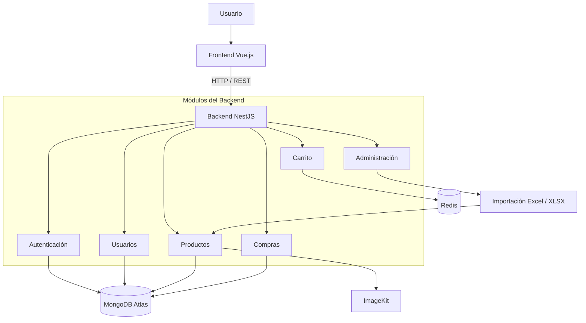

# Tienda Online de Videojuegos — E-commerce Full Stack

**NestJS | Vue.js | MongoDB Atlas | Redis | JWT | ImageKit**

Plataforma de comercio electrónico orientada a la venta de videojuegos, desarrollada utilizando una arquitectura cliente-servidor con **NestJS en el backend y Vue.js en el frontend**.

El sistema permite gestionar un catálogo de videojuegos, administrar usuarios, manejar carritos de compras y registrar transacciones, integrando tecnologías de persistencia NoSQL, almacenamiento temporal en caché y servicios externos para la gestión de imágenes.

El proyecto fue desarrollado con el objetivo de aplicar conocimientos de desarrollo full stack, diseño de APIs REST, autenticación, administración de bases de datos y optimización del acceso a información mediante Redis.

## Tecnologías utilizadas

| Categoría | Tecnologías |
|---|---|
| Backend | NestJS, Node.js, TypeScript |
| Frontend | Vue.js, JavaScript |
| Base de datos | MongoDB Atlas |
| ODM | Mongoose |
| Caché y carrito | Redis, Redis Cloud |
| Autenticación | JWT |
| Almacenamiento de imágenes | ImageKit |
| Importación de datos | Excel, XLSX |
| Comunicación | REST API |
| Control de versiones | Git, GitHub |

## Arquitectura del sistema

La plataforma utiliza una arquitectura cliente-servidor, donde el frontend desarrollado con Vue.js consume una API REST implementada con NestJS.

El backend está organizado mediante módulos independientes, separando las responsabilidades de autenticación, usuarios, productos, compras, administración y carrito.

MongoDB Atlas permite almacenar la información persistente, mientras que Redis se utiliza para gestionar temporalmente los carritos de compras.

ImageKit proporciona almacenamiento externo para las imágenes de los videojuegos.

### Diagrama de arquitectura



La separación modular permite mantener organizada la lógica de negocio y facilita la incorporación de nuevas funcionalidades.

## Funcionalidades principales

### 1. Autenticación y gestión de usuarios

El sistema incorpora mecanismos de autenticación mediante JSON Web Tokens (JWT).

**Funcionalidades:**

- Registro de usuarios.
- Inicio de sesión.
- Generación y validación de tokens JWT.
- Protección de rutas que requieren autenticación.
- Gestión de información de usuarios.
- Control de acceso a funcionalidades administrativas.

La autenticación permite identificar a los usuarios y proteger las operaciones del sistema.

### 2. Catálogo de videojuegos

El módulo de productos administra la información de los videojuegos disponibles en la tienda.

Cada producto contempla los siguientes atributos:

| Campo | Descripción |
|---|---|
| `nombre` | Nombre del videojuego |
| `categorias` | Categorías asociadas al producto |
| `precio` | Precio de venta |
| `stock` | Cantidad disponible |
| `urlImagen` | Dirección de la imagen almacenada externamente |

**Funcionalidades:**

- Registro de videojuegos.
- Consulta del catálogo.
- Administración de información de productos.
- Gestión de precios y disponibilidad.
- Clasificación mediante categorías.
- Asociación de imágenes a los productos.

### 3. Carrito de compras con Redis

Una de las principales características técnicas del proyecto es la utilización de **Redis para gestionar el carrito de compras**.

En lugar de almacenar cada modificación del carrito directamente en la base de datos principal, se utiliza almacenamiento temporal en memoria.

**Funcionalidades:**

- Agregar productos al carrito.
- Consultar los productos seleccionados.
- Modificar el contenido del carrito.
- Eliminar productos.
- Mantener carritos asociados a usuarios.
- Aplicar expiración automática mediante TTL.

### Estrategia de almacenamiento

Los carritos utilizan claves asociadas al identificador del usuario.

```text
carro:<usuario>
```

Se trabajó con tiempos de expiración configurables de aproximadamente 30 a 60 minutos.

**Beneficios de Redis:**

- Acceso rápido a la información temporal.
- Reducción de operaciones sobre MongoDB.
- Expiración automática de carritos inactivos.
- Separación entre datos transitorios y persistentes.
- Mejor organización de las responsabilidades de almacenamiento.

También se trabajó con Redis Cloud y configuraciones de conexión segura mediante TLS.

### 4. Gestión de compras

El módulo de compras permite administrar las operaciones relacionadas con la adquisición de videojuegos.

**Responsabilidades:**

- Procesamiento de solicitudes de compra.
- Registro de información de transacciones.
- Asociación de compras con usuarios.
- Integración con el catálogo de productos.
- Persistencia de información en MongoDB.

### 5. Administración de productos

El sistema incorpora un módulo administrativo para gestionar las operaciones relacionadas con los productos de la tienda.

**Funcionalidades:**

- Administración del catálogo.
- Registro y actualización de productos.
- Gestión de stock y precios.
- Organización de categorías.
- Importación masiva de videojuegos.

### 6. Importación masiva desde Excel

Se implementó una funcionalidad de importación de productos mediante archivos Excel utilizando la librería `xlsx`.

Esta característica permite procesar registros de videojuegos sin necesidad de ingresarlos individualmente.

**Proceso de importación:**

1. Lectura del archivo Excel.
2. Obtención de los registros desde la primera hoja.
3. Extracción de los campos correspondientes a cada producto.
4. Procesamiento de las categorías separadas por comas.
5. Transformación de los datos a la estructura utilizada por el sistema.
6. Registro de los productos en MongoDB.

Esta funcionalidad facilita la carga inicial y la administración de grandes cantidades de productos.

### 7. Gestión de imágenes con ImageKit

El sistema integra **ImageKit** para gestionar las imágenes asociadas a los videojuegos.

En lugar de almacenar los archivos directamente en MongoDB, se utilizan direcciones URL que referencian las imágenes alojadas externamente.

**Ventajas:**

- Separación entre información del producto y archivos multimedia.
- Almacenamiento externo de imágenes.
- Simplificación del modelo de datos.
- Integración de imágenes mediante URL.
- Mayor facilidad para administrar recursos multimedia.

## Estructura del backend

El backend está desarrollado con NestJS, aprovechando su arquitectura modular basada en módulos, controladores y servicios.

```text
back-tienda-online-juegos/
│
├── src/
│   ├── auth/
│   ├── user/
│   ├── producto/
│   ├── compra/
│   ├── admin/
│   ├── carro/
│   │
│   ├── app.module.ts
│   └── main.ts
│
├── package.json
├── tsconfig.json
└── README.md
```

### Responsabilidades de los módulos

| Módulo | Responsabilidad |
|---|---|
| `auth` | Autenticación y autorización |
| `user` | Gestión de usuarios |
| `producto` | Administración del catálogo |
| `compra` | Gestión de compras |
| `admin` | Funcionalidades administrativas |
| `carro` | Administración del carrito con Redis |

Esta organización facilita la separación de responsabilidades y el mantenimiento de la aplicación.

## Persistencia con MongoDB Atlas

La plataforma utiliza **MongoDB Atlas** como base de datos NoSQL alojada en la nube.

La integración se realiza mediante Mongoose, que permite definir esquemas y administrar documentos desde NestJS.

### Características

- Persistencia de usuarios.
- Almacenamiento de videojuegos.
- Registro de compras.
- Modelado de documentos mediante esquemas.
- Integración con servicios y módulos NestJS.
- Consultas y operaciones sobre colecciones MongoDB.

La utilización de MongoDB permite trabajar con documentos y estructuras de datos adaptadas a las entidades del comercio electrónico.

## Integración con Redis

Redis se utiliza como sistema de almacenamiento temporal para el carrito de compras.

Durante el desarrollo se trabajó con configuraciones locales y servicios administrados mediante Redis Cloud.

La integración contempló:

- Configuración de conexión.
- Manejo de claves asociadas a usuarios.
- Definición de tiempos de expiración.
- Integración con los servicios de NestJS.
- Configuración de conexiones seguras mediante TLS.
- Manejo de errores de conectividad.

Se trabajó con librerías del ecosistema de caché de NestJS, incluyendo `cache-manager-redis-yet`.

## Instalación y ejecución

### Requisitos previos

Para ejecutar el backend se requiere:

- Node.js y npm.
- Una instancia de MongoDB accesible.
- Una instancia de Redis.
- Credenciales de los servicios externos utilizados.

### Clonar el repositorio

```bash
git clone <URL_DEL_REPOSITORIO>
cd back-tienda-online-juegos
```

### Instalar dependencias

```bash
npm install
```

### Configurar variables de entorno

Crear el archivo `.env` de acuerdo con las variables utilizadas en la configuración del proyecto.

Se deben proporcionar las credenciales y direcciones de conexión correspondientes a MongoDB Atlas, Redis, JWT e ImageKit.

Las credenciales privadas no deben incorporarse al repositorio.

### Ejecutar en desarrollo

```bash
npm run start:dev
```

### Ejecutar en modo normal

```bash
npm run start
```

### Ejecutar en producción

```bash
npm run build
npm run start:prod
```

## Pruebas

El proyecto utiliza la estructura de scripts de NestJS para ejecutar pruebas.

### Pruebas unitarias

```bash
npm run test
```

### Pruebas end-to-end

```bash
npm run test:e2e
```

### Cobertura de pruebas

```bash
npm run test:cov
```

## Desarrollo y responsabilidades

El proyecto permitió trabajar en el desarrollo e integración de una plataforma de comercio electrónico, abordando funcionalidades de frontend, backend, persistencia y servicios externos.

### Desarrollo frontend

- Construcción de la interfaz utilizando Vue.js.
- Integración con los endpoints REST del backend.
- Presentación del catálogo de videojuegos.
- Implementación de funcionalidades de interacción con los usuarios.

### Desarrollo backend

- Diseño de una API REST utilizando NestJS.
- Organización del código mediante módulos.
- Implementación de lógica de negocio.
- Desarrollo de funcionalidades de autenticación, productos, compras y carrito.
- Integración con servicios externos.

### Bases de datos y caché

- Configuración de MongoDB Atlas.
- Modelado de información mediante Mongoose.
- Integración de Redis.
- Implementación de almacenamiento temporal para carritos.
- Configuración de expiración automática de datos.

### Integraciones

- Autenticación mediante JWT.
- Almacenamiento de imágenes con ImageKit.
- Importación de información desde Excel.
- Conexión con Redis Cloud.

## Desafíos técnicos

### Integración de Redis con NestJS

Uno de los principales desafíos fue configurar correctamente Redis dentro del ecosistema de NestJS.

Durante el desarrollo se presentaron problemas de compatibilidad entre versiones de librerías, configuración del gestor de caché y conexión con el servidor Redis.

Fue necesario revisar las dependencias y adaptar la configuración para integrar el almacenamiento temporal con los servicios de la aplicación.

### Conectividad con Redis Cloud

La conexión con Redis Cloud requirió trabajar con parámetros de conexión, autenticación y TLS.

También se abordaron errores relacionados con intentos de conexión a instancias locales y configuraciones incorrectas del cliente.

### Importación y transformación de datos

La carga masiva de videojuegos desde Excel requirió transformar los registros originales al formato esperado por MongoDB.

En particular, fue necesario procesar las categorías para convertir valores separados por comas en arreglos compatibles con el modelo de productos.

### Integración de servicios externos

La utilización de MongoDB Atlas, Redis Cloud e ImageKit permitió abordar desafíos relacionados con la conexión a servicios externos, configuración de credenciales y manejo de información entre diferentes componentes.

## Aprendizajes

El desarrollo de la tienda online permitió fortalecer conocimientos de ingeniería de software y desarrollo de aplicaciones web.

Entre los principales aprendizajes destacan:

- Desarrollo de APIs REST con NestJS.
- Arquitectura modular de aplicaciones backend.
- Desarrollo frontend con Vue.js.
- Autenticación mediante JWT.
- Modelado de datos NoSQL con MongoDB y Mongoose.
- Implementación de almacenamiento temporal con Redis.
- Administración de tiempos de expiración mediante TTL.
- Integración de servicios administrados en la nube.
- Procesamiento e importación de archivos Excel.
- Gestión de recursos multimedia mediante servicios externos.
- Diagnóstico de problemas de conectividad y dependencias.

## Contexto del proyecto

| Característica | Descripción |
|---|---|
| Proyecto | Tienda Online de Videojuegos |
| Tipo | E-commerce Full Stack |
| Arquitectura | Cliente-servidor, backend modular |
| Frontend | Vue.js |
| Backend | NestJS / TypeScript |
| Base de datos | MongoDB Atlas |
| Caché | Redis |
| Autenticación | JWT |
| Imágenes | ImageKit |
| Importación | Excel / XLSX |
| Comunicación | REST API |

## Conclusión

La Tienda Online de Videojuegos representa una implementación full stack de una plataforma de comercio electrónico, integrando tecnologías de desarrollo web, bases de datos NoSQL, autenticación y almacenamiento temporal.

Uno de los principales aspectos técnicos del proyecto es la utilización de **Redis para gestionar los carritos de compras**, separando los datos temporales de la información persistente almacenada en MongoDB Atlas.

El proyecto permitió aplicar conocimientos de arquitectura modular, desarrollo de APIs REST, integración de servicios externos y gestión de datos, consolidando una solución orientada a las funcionalidades principales de un comercio electrónico.
